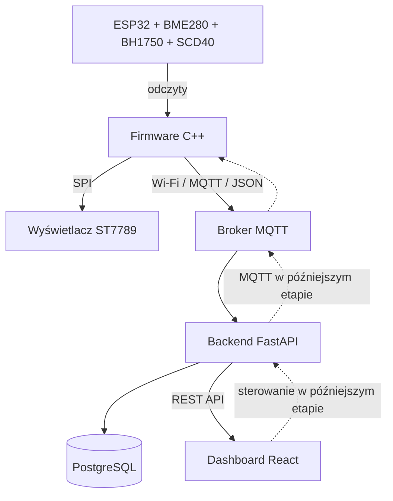

# Architektura systemu (plan)

## Słownik
- **Firmware** — program działający bezpośrednio na ESP32.
- **I²C** — magistrala do komunikacji m.in. z BME280, BH1750 i SCD40.
- **SPI** — szybka magistrala komunikacyjna, m.in. do ST7789.
- **MQTT** — protokół wymiany wiadomości, popularny w IoT.
- **Broker** — pośrednik rozsyłający wiadomości MQTT.
- **JSON** — format zapisu danych jako pary klucz-wartość.
- **Backend** — program na komputerze/serwerze przetwarzający dane.
- **API** — interfejs, przez który aplikacje wymieniają informacje.
- **Frontend** — interfejs w przeglądarce.

## Decyzje projektowe
- Zasilanie urządzenia: USB 5 V.
- Prototyp najpierw na płytce stykowej, nie lutujemy przed testami.
- Czujniki instalujemy po kolei, zaczynając od BME280.
- SCD40 pozostaje częścią planu, ale nie blokuje pierwszego MVP.
- Projekt dzielimy na niezależne etapy i zapisujemy działające wersje w Git.
